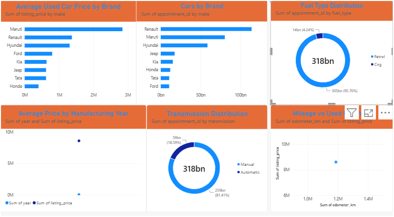
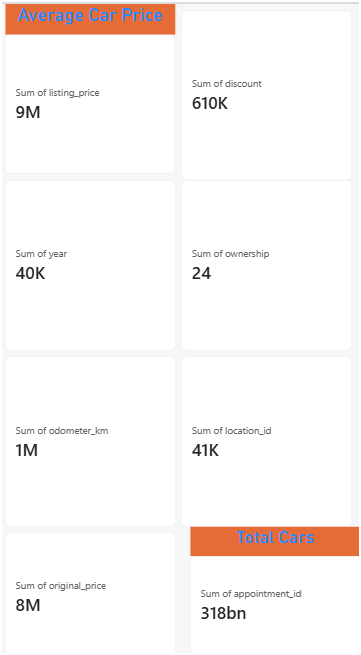

# 🚗 Cars24 Used Car Market Analysis

## 📊 End-to-End Data Analytics & Business Intelligence Project

An end-to-end data analytics project that collects used-car listing data from Cars24, processes and analyzes it using Python, creates visualizations, and presents the findings through a Power BI dashboard.

**Tools:** Python, Selenium, BeautifulSoup, Pandas, NumPy, Matplotlib, Seaborn, Power BI

---

## 🎯 Project Overview

This project explores used-car listings to understand:

- Vehicle inventory by brand and body type
- Used-car pricing patterns
- Fuel type and transmission distribution
- Vehicle age and mileage patterns
- Relationship between mileage and price
- Discounts offered on listings
- Location-level inventory distribution

---

## 🏆 Project Workflow

```text
Cars24 Website
      ↓
Web Scraping (Selenium / BeautifulSoup)
      ↓
Raw Data Extraction → Raw CSV
      ↓
Data Cleaning and Validation
      ↓
Exploratory Data Analysis (EDA)
      ↓
Python Visualizations
      ↓
Power BI Dashboard
      ↓
Business Insights
```

---

## 💡 Key Insights

**Dataset:** 20 listings from 16 locations across India, covering vehicles manufactured between 2016 and 2024.

1. **Budget market:** Median listing price is ₹3.94 lakh, with prices ranging from ₹2.09 lakh to ₹8.00 lakh. Hatchbacks account for 70% of the sample.
2. **Brand concentration:** Maruti has 7 listings and Renault has 5, together accounting for 60% of the sample.
3. **SUV pricing premium:** Median SUV price is ₹6.22 lakh versus ₹3.52 lakh for hatchbacks, approximately 1.8 times higher.
4. **Transmission pricing:** Automatic cars average ₹5.81 lakh versus ₹3.92 lakh for manual cars, approximately 48% higher. Only 4 of the 20 listings are automatic.
5. **Fuel distribution:** 19 listings are petrol vehicles and 1 is CNG.
6. **Mileage and price:** Kilometres driven have a weak correlation with listing price (0.17), while manufacturing year has a stronger correlation (0.37).
7. **Discounts:** 18 of 20 cars are listed below their recorded original prices, with an average discount of 6.6%. The largest recorded discount is 21% on a 2018 Jeep Compass.
8. **Ownership and discounts:** Second-owner cars show an average discount of 11%, compared with 6% for first-owner cars.

> **Important limitation:** These results describe a sample of 20 listings and should not be generalized to the entire used-car market. Discount findings depend on the accuracy of the recorded original prices.

---

## 📊 Power BI Dashboard

### Market Overview



### Price Analysis



---

## 📁 Repository Structure

| Folder | Contents |
|---|---|
| `01_Web_Scraping` | Selenium scraper and data extraction scripts |
| `02_Raw_Data` | Saved HTML pages and raw CSV |
| `03_Cleaned_Data` | Data-cleaning scripts and cleaned dataset |
| `04_EDA` | EDA scripts and summary tables |
| `05_Visualizations` | Python charts |
| `06_PowerBI` | Power BI dashboard and screenshots |
| `07_Report` | Project report |
| `08_Presentation` | Presentation materials |

---

## ▶️ How to Run

Install the required dependencies:

```bash
pip install -r requirements.txt
```

Run the project entry point if `main.py` exists in the repository:

```bash
python main.py
```

**Note:** Update these commands to match the actual filenames and execution steps in your repository. Some projects use separate scripts for scraping, cleaning, and analysis.

---

## 🔍 Future Improvements

- Expand the dataset to at least 300–500 listings across multiple pages and cities.
- Validate and correct suspicious original-price values before calculating discounts.
- Handle missing values, duplicates, and inconsistent data types.
- Recalculate all insights using the expanded and validated dataset.
- Enhance the Power BI dashboard with additional filters and market comparisons.

---

## 👨‍💻 Author

**Ummadisetty Mohith Srinath**

- [LinkedIn](https://linkedin.com/in/mohithsrinath-ummadisetty-61480b23a)
- [GitHub](https://github.com/1mohith-2003)
- Email: mohithsrinath2003@gmail.com
